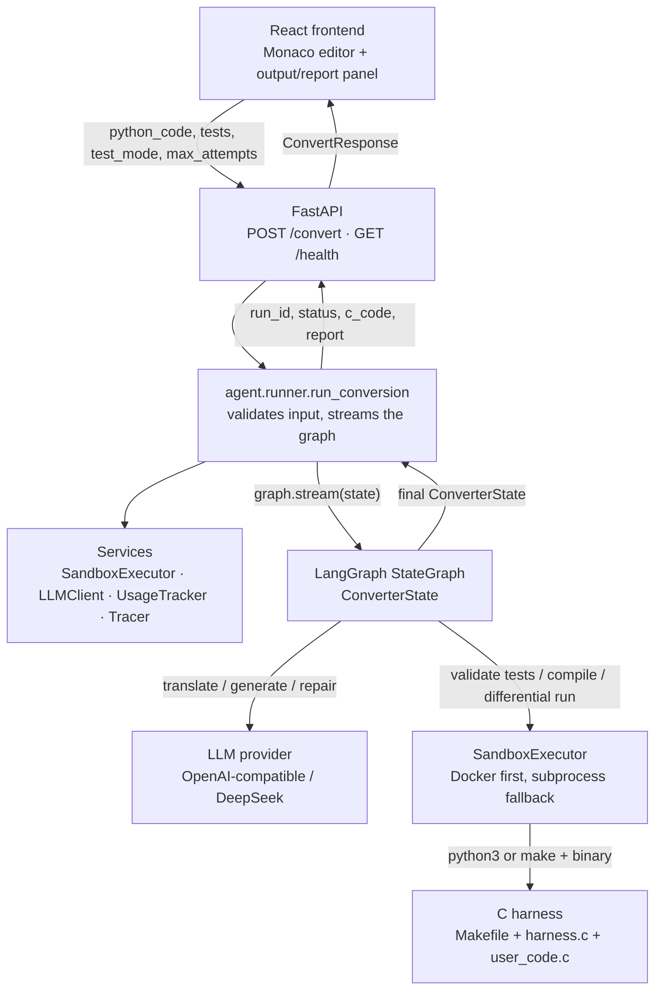
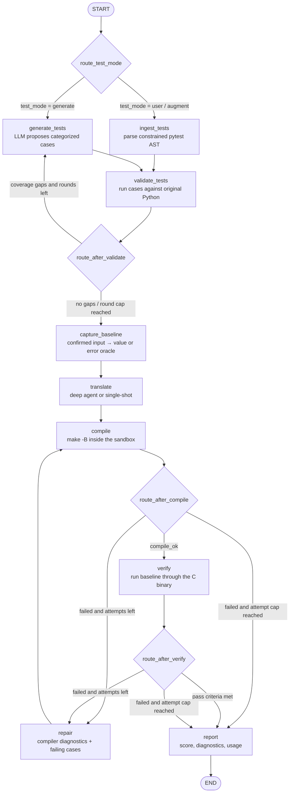
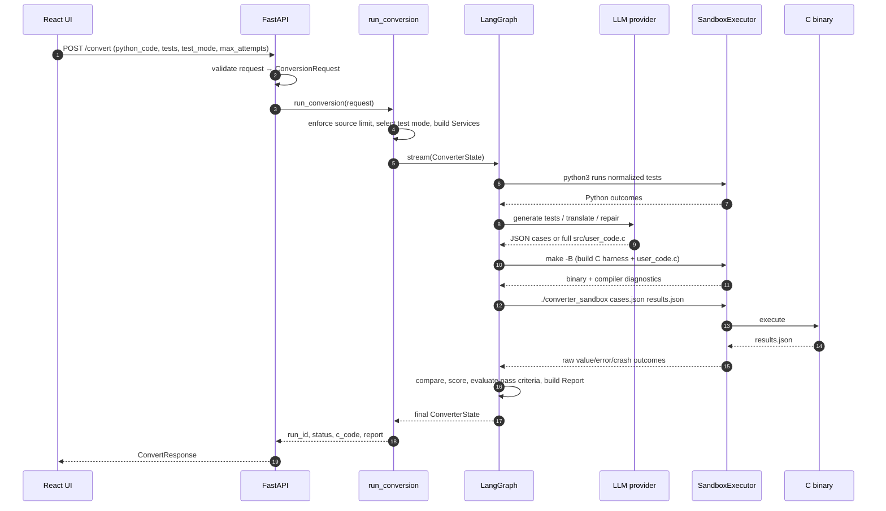
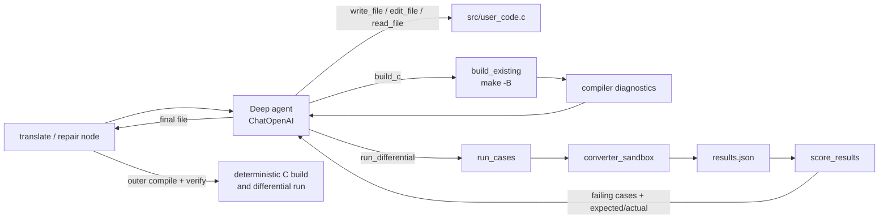
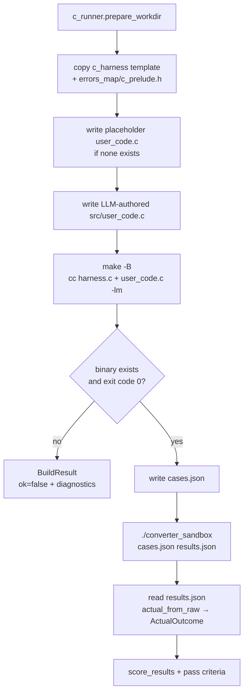

# Code Flow

Mermaid diagrams for the Python-to-C converter. See `README.md` for the prose
architecture and `STATUS.md` for the current verification snapshot.

## 1. System overview

## 2. Conversion graph

The graph has three loops: test regeneration, translation repair, and the
verification gate. `report` is terminal.

## 3. `POST /convert` sequence

## 4. Deep-agent translate/repair loop

The inner agent owns only `src/user_code.c`; the outer graph still recompiles
and re-verifies it, so the agent never certifies itself.

## 5. Sandbox build/run internals

## 6. Key modules

| Layer | Module | Responsibility |
|---|---|---|
| API | `converter/api/main.py` | `/health`, `/convert`, CORS, serves `frontend/dist` |
| Orchestration | `converter/agent/runner.py` | validate input, build services, stream graph |
| Graph | `converter/agent/graph.py`, `routing.py` | node wiring, branches, loop caps |
| Nodes | `converter/agent/nodes/*` | ingest, generate, validate, baseline, translate, compile, verify, repair, report |
| Testing | `converter/testing/*` | pytest AST ingestion, generation, validation, baseline |
| Translation | `converter/translation/*` | prompts and LLM-facing translate/repair |
| Deep agent | `converter/agent/deepagent.py` | filesystem backend, `build_c`, `run_differential`, usage callback |
| Sandbox | `converter/sandbox/executor.py` | Docker-first isolation, subprocess fallback |
| C runner | `converter/sandbox/c_runner.py` | prepare workdir, build, run cases |
| C harness | `converter/sandbox/c_harness/` | JSON I/O, argument/value helpers, `dispatch` |
| Errors | `converter/errors_map/mapping.py`, `c_prelude.h` | Python exception → `ConvErrorKind` |
| Verification | `converter/verification/*` | differential comparison, scoring, pass criteria |
| UI | `frontend/src/App.tsx` | VS Code-style editor, conversion controls, report panel |
